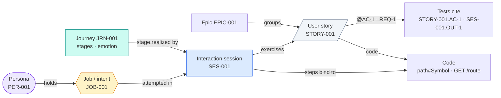

# Product docs — personas, intents, interaction sessions & stories

**Decision [0023](decisions/0023-product-docs-intent-sessions.md).** Code docs
explain *what the code is*. Product docs explain *what the product is for*:
who uses it, the intents they arrive with, and how each intent plays out end
to end. necronomidoc treats them as first-class documentation. They are
written in a standard format in each repo's `docs/product/` folder, validated
against the code and tests on every build, diagrammed, and served to humans
(the **Product** pages) and agents (MCP, `llms.txt`).

The goal is a written, accepted statement of user intent that drives testing
and verification and stops development drifting from it.

```bash
necronomidoc product init                                  # scaffold docs/product/
necronomidoc product new session --title "Shopper re-orders an item"
necronomidoc product lint                                  # validate; non-zero exit on errors (CI)
necronomidoc enrich <repo> --product                       # or: LLM-draft a first set
necronomidoc product export <repo> --out docs/product      # …and promote the drafts
```

(From a checkout of this repo, `necronomidoc` is `node packages/cli/dist/index.js`.)

## The model in one picture



## Research foundation: standard formats, not a bespoke one

Each document type uses an established practice, so the format is familiar to
people and to the LLMs that write it.

| Document | Standard it follows | What it captures |
|---|---|---|
| Persona (`PER-`) | Personas (Cooper, *The Inmates Are Running the Asylum*) | Who: role, goals, frustrations, context, permissions |
| Job (`JOB-`) | Jobs-to-be-Done **job stories** (Klement): *"When ⟨situation⟩, I want to ⟨motivation⟩, so I can ⟨outcome⟩"* | The **intent**. Solution-agnostic, so it survives rewrites |
| Epic (`EPIC-`) | Agile epics | A body of work grouping stories under jobs |
| Story (`STORY-`) | **User stories** (Connextra *"As a…, I want…, so that…"*), sized by **INVEST** | A unit of delivery |
| Acceptance criteria | **Gherkin** (Given/When/Then, the Cucumber/BDD language) | Executable, observable behaviour, one `@AC-n` scenario each |
| Requirements | **EARS** (Mavin et al.: *"WHEN ⟨trigger⟩ THE ⟨system⟩ SHALL ⟨response⟩"*), the notation spec-driven AI tools such as Kiro use | System rules, optional |
| Story map | **User story mapping** (Patton): activities → steps → release slices | Generated from the stories' `activity` / `step` / `release` |
| Journey (`JRN-`) | **Customer journey maps**: stages × actions, touchpoints, thoughts, emotion, pain points, opportunities | The experience across time, including how it feels |
| Session (`SES-`) | Fuses **use cases** (Cockburn: main success scenario + extensions), **Event Modeling** (Dymitruk: screen → command → event → view, from the user's view), **Arazzo** workflows (OpenAPI Initiative: ordered steps with success criteria) and the **Screenplay** test pattern (actors performing tasks toward a goal) | One intent, end to end |

Diagrams are **Mermaid** (`flowchart`, `sequenceDiagram`, `journey`). Mermaid
renders on GitHub, in the doc site, and in most agent UIs.

## Intent interaction sessions (`SES-`)

An interaction session starts when a user arrives with a **preconceived
intent**: they log in, open the CLI, or an agent connects. The session follows
that intent from end to end:

- **Entry state:** persona, channel (web / cli / mcp / api / …), auth/role,
  and preconditions.
- **The declared intent:** the job it serves (`job: JOB-…`) and the intent in
  the user's own words (`intent:`), plus what triggered it.
- **Steps** `S1, S2, …`. Each step records who acts, what they do, the
  **surface** they touch, what the **system** does in response, and what the
  user **sees** (the evidence that it worked).
- **Branches:** the alternatives the user can hit (`when` → a step or an
  outcome).
- **Outcomes** `OUT-1, OUT-2, …`, each with a kind: `fulfilled`, `partial`,
  `diverted`, `abandoned` or `failed`. Each has observable success criteria.
  Every session needs a reachable `fulfilled` outcome.
- **Code bindings:** each step lists the code it exercises. This is what
  makes the session checkable against the code.

Use cases and journey maps don't do all three of these:

1. **It is verified against the code.** Each step's `code:` resolves against
   the extracted doc model at build time. When a bound function is deleted,
   the binding is **broken** (an error on accepted docs). When it changes
   under an unedited doc, the binding is **changed** and the session is
   flagged for review.
2. **It is verified by tests.** Tests cite outcome ids
   (`[SES-001.OUT-1] shopper ends on the order confirmation`), and every way
   the session can end is expected to be covered.
3. **It answers "what breaks if I change this?"** Bindings run both ways.
   `find_intents_for_code` (MCP) and the chips on file pages list the
   sessions and stories that run through a file, with the outcomes and
   criteria to preserve.

```yaml
---
id: SES-001
title: Returning shopper buys a known item
status: accepted
persona: PER-001
job: JOB-001
intent: "I need sku-1 again — just let me pay for it."
trigger: Ran out of the item at home
entry:
  channel: web
  auth: signed in as customer
  preconditions: [The shopper has a saved payment method]
steps:
  - id: S1
    action: Opens the cart
    surface: "`CartPage`"            # backticked names that resolve are bound automatically
    expects: Cart shows its items
    emotion: 4
  - id: S2
    action: Checks out
    system: POST /checkout             # endpoint mentions are bound automatically too
    code: [src/api/cart.ts#checkout]   # explicit bindings
    expects: Order confirmation
    outcome: OUT-1
    branches:
      - when: Payment is declined
        goto: OUT-2
outcomes:
  - id: OUT-1
    kind: fulfilled
    title: Order placed
    criteria: [OrderPage shows the order id]
  - id: OUT-2
    kind: abandoned
    title: Leaves after a declined payment, cart intact
    criteria: [Cart still holds the item]
stories: [STORY-001]
journey: { id: JRN-001, stage: Buy }
---

# Returning shopper buys a known item

## Narrative

Two or three sentences telling the session as a story.
```

The build generates three diagrams for each session: a **flow** (steps,
branches, outcomes, colour-coded by kind), a **sequence** (user ↔ product ↔
system), and an **emotion curve** (Mermaid `journey`, when steps carry
`emotion` 1–5).

Step semantics: `next` defaults to the following step. `outcome` ends the
session. `actor` is `user` by default, `system`, or a named external actor
(an approver, a webhook sender), which gets its own lane in the sequence
diagram.

## Layout

```
docs/product/
  README.md        the product narrative (shown atop the Product page)
  glossary.md      the shared vocabulary
  personas/        PER-001-<slug>.md
  jobs/            JOB-001-<slug>.md
  sessions/        SES-001-<slug>.md
  journeys/        JRN-001-<slug>.md
  epics/           EPIC-001-<slug>.md
  stories/         STORY-001-<slug>.md
  _templates/      one template per type (never published)
  schema.json      JSON Schema for the frontmatter (generated by `product init`)
```

One file per document. Structured fields go in **YAML frontmatter**;
narrative, Gherkin and EARS go in the markdown **body**. The id prefix sets the
type (`type:` is optional and must agree with it). Ids are `PREFIX-<digits>`;
use three-digit zero-padding (`STORY-007`). References compare numerically,
so a test citing `STORY-7` matches `STORY-007`. Any field that takes a list of
ids also accepts a single id. Folders and files starting with `_` are ignored.
A free-form page (glossary, notes) is fine anywhere except inside a type
folder.

## Fields by type

Every document: `id`, `title`, `status` (`draft` · `proposed` · `accepted` ·
`implemented` · `deprecated`), optional `owner`, `tags`, and `verified` (see
[Drift](#drift-broken-and-changed-bindings)).

| Type | Fields |
|---|---|
| persona | `summary`, `role`, `goals[]`, `frustrations[]`, `context`, `expertise` (novice/intermediate/expert), `permissions[]` |
| job | `personas[]`, `situation`, `motivation`, `outcome`, `importance` (low…critical), `successMetrics[]` |
| epic | `summary`, `jobs[]` |
| story | `persona`, `want`, `soThat`, `jobs[]`, `epic`, `activity`, `step`, `release`, `priority` (must/should/could/wont), `code[]`; criteria and requirements in the body |
| journey | `persona`, `jobs[]`, `stages[]`: `name`, `goal`, `actions[]`, `touchpoints[]`, `thoughts[]`, `emotion` 1–5, `painPoints[]`, `opportunities[]`, `sessions[]`, `stories[]` |
| session | `persona`, `job`, `intent`, `trigger`, `entry{channel, auth, preconditions[]}`, `steps[]`, `outcomes[]`, `stories[]`, `journey` (id or `{id, stage}`), `metrics[]` |

`necronomidoc export-schemas` prints every schema. The `ProductFrontmatter`
entry, also written to `docs/product/schema.json`, is a JSON Schema that agents
and editors can validate frontmatter against.

### Acceptance criteria (Gherkin) and requirements (EARS)

Story and session bodies carry criteria. Each Gherkin scenario is one
criterion, tagged with its id:

````markdown
## Acceptance criteria

```gherkin
@AC-1
Scenario: Payment declined keeps the cart
  Given a cart with "sku-1"
  When the payment is declined
  Then the cart still lists "sku-1"
```

## Requirements (EARS)

- **REQ-1** WHEN the payment provider declines THE shop SHALL keep the cart unchanged
- **REQ-2** IF the session expires, THEN THE shop SHALL keep the cart for 24 hours
````

The linter warns about scenarios without an `@AC-n` tag (it assigns an id, but
pin one so tests stay stable), scenarios without a `Then`, and requirements
that don't follow an EARS template. The templates are ubiquitous, event-driven
(`WHEN`), state-driven (`WHILE`), unwanted behaviour (`IF … THEN`),
optional feature (`WHERE`), and complex combinations of those.

## Code bindings

| Reference | Binds to |
|---|---|
| `GET /orders/{id}` | an OpenAPI operation (method is case-insensitive) |
| `src/api/cart.ts#checkout` / `#Class.method` | a symbol in a file |
| `src/api/cart.ts` | a file |
| `src/checkout/` | every documented file under a directory |
| `checkout` | a symbol by bare name, only when exactly one matches |

Explicit bindings live in `code:` (on stories and on session steps). The
build also binds **automatically** from session step text: any backticked
name that resolves, and any `METHOD /path` mention. A mention that doesn't
resolve is treated as prose, never as an error.

### Drift: broken and changed bindings

- **broken:** the target no longer exists. This is an **error** on
  `accepted`/`implemented` docs and a warning on drafts. The documented
  behaviour has drifted from the product.
- **changed:** the target's content hash moved since the doc was last edited.
  The doc is flagged **stale** ("drift") and stays flagged on every rebuild
  until a human reviews it. Edit the doc, or just bump `verified: 2026-11-19`,
  and the bindings re-baseline. The baseline is the previously published
  `product.json`, so it needs no extra state.

## Traceability: tests cite ids

Tests name the ids they verify. Only **deliberate citations** count; an id
that merely appears in an assertion or in test data does not:

```ts
it("[STORY-001.AC-2] keeps the cart when payment is declined", …);   // bracketed in a title
it("[SES-001.OUT-1] [STORY-001.AC-1] adds and pays", …);             // several per test
```

```gherkin
@SES-001.OUT-2
Scenario: Leaves after a declined payment
```

```python
def test_story_1_ac_2_keeps_cart_on_decline(): ...                  # identifier form
```

The build scans the working tree's test files (`*.test.*`, `*.spec.*`,
`test_*.py`, `*_test.go`, `*Tests.cs`, `*.feature`, `tests/`, `e2e/`, …),
skipping `fixtures/` and `testdata/`. It reports:

- for each `accepted`/`implemented` story, any criterion or requirement no
  test cites (`untested-criteria`);
- for each such session, any outcome no test cites (`untested-outcomes`);
- tests citing ids that no doc defines (`orphan-test-ref`);
- coverage totals on the Product page and in `product lint`.

Coverage is opt-in by status. Drafts never nag.

Skipped or pending declarations (`it.skip(`, `test.fixme(`, `xit(`,
`@wip`/`@skip` tags…) don't count: a citation in a test that doesn't run is a
TODO, not verification. `necronomidoc product checks` (and the MCP tool
`get_session_checks`) generate exactly such skipped skeletons per session
outcome, ready to fill in ([agent tools](agent-tools.md#executable-session-checks-get_session_checks)).

## Interaction surfaces

The build lists the repo's **surfaces**: every OpenAPI operation, plus
exported components named `…Page` / `…View` / `…Screen` / `…Route` /
`…Dialog` / `…Modal` or living under `pages/`, `routes/`, `screens/` or
`views/`. It then records which sessions touch each one. A surface that no
session touches is an intent the docs don't describe yet (`uncovered-surfaces`).
That makes a new endpoint with no documented user intent visible.

## Validation findings

| Code | Level | Meaning |
|---|---|---|
| `frontmatter-invalid` · `frontmatter-missing` · `schema` · `bad-id` · `id-type-mismatch` | error | The document can't be read; it is skipped and everything else still publishes |
| `duplicate-id` · `duplicate-criterion` · `duplicate-requirement` · `duplicate-step` · `duplicate-outcome` | error | Ids must be unique |
| `dangling-ref` · `wrong-ref-type` | error | A reference names a missing doc, or a doc of the wrong type |
| `unknown-target` | error | A `next` / `goto` / `outcome` names no step or outcome |
| `no-fulfilled-outcome` · `intent-unreachable` | error | The intent can't be completed as documented |
| `broken-binding` | error (accepted+) / warn | Bound code no longer exists |
| `changed-binding` | warn | Bound code changed since the doc was verified |
| `unreachable-step` · `unreachable-outcome` · `dead-end-step` | warn | Session graph smells |
| `untagged-scenario` · `scenario-no-then` · `ears-pattern` · `no-acceptance` | warn | Criteria quality |
| `untested-criteria` · `untested-outcomes` · `orphan-test-ref` | warn | Traceability gaps (accepted+ docs) |
| `unknown-field` · `id-dir-mismatch` · `todo-marker` · `unknown-stage` | warn | Hygiene |
| `uncovered-surfaces` · `override-shadowed` · `adapter-skipped` | info | Context |

`necronomidoc product lint [repo]` runs exactly what a build runs: extraction
for bindings, the test scan, and every check. It exits **1 on errors** (and on
warnings with `--strict`). `--json` gives machine-readable output. A CI step:

```yaml
- run: npx necronomidoc product lint . --strict
```

## Source precedence

Product docs resolve like [core docs](core-docs.md):

1. **repo:** `docs/product/**` in the source repo. These are read from the
   extracted markdown, so pre-extracted IR (`POST /api/ir`) works too.
2. **override:** `data/enrichment/<slug>/product/**`, the same layout,
   server-side. Merged with repo docs **by id**; the repo file wins a clash.
3. **llm:** `data/enrichment/<slug>/product.llm.json`, written by
   `enrich --product`. It is used **only when no curated doc exists**
   (whole-set semantics), and flagged stale when the code changes.

## Getting the first docs written

**By hand or by any agent.** `product init` scaffolds the folder, templates
and `schema.json`. `product new <type> --title …` creates the next id from
its template; YAML comments explain each field and `TODO(doc):` marks every
value to replace. Any coding agent can fill the templates, validate against
`schema.json`, and run `product lint` until it passes.

**With necronomidoc's enrichment.** `enrich <repo> --product` drafts a full
set from the extracted model (files, exported symbols, surfaces, README):
personas, jobs, sessions bound to real code refs, stories with Gherkin and
EARS, and journeys. Drafts are `status: proposed` and labelled LLM on the
site. Review them, then run `product export <repo> --out docs/product` and
commit. Once curated, the LLM never rewrites them. No API key? Use
`enrich --product --export-tasks tasks.json`, have a local agent complete
the task, then `--import-results` ([enrichment.md](enrichment.md)).

## Where product docs appear

- **Site:** `/r/<slug>/product` (narrative, coverage, intent-map diagram,
  documents by type, findings, surfaces); `/product/map` (the story map);
  `/product/trace` (intent → session → outcome → test, story → criterion →
  test, with drift); `/product/<ID>` (one document, with diagrams,
  bindings, tests and backlinks). File pages show **serves intents** chips,
  and a product doc's markdown page links to its structured view.
- **MCP:** `get_product_overview`, `get_product_doc`,
  `find_intents_for_code`; `search_docs` returns `type: "product"` hits.
- **llms.txt:** an intents & sessions section after the core docs.
- **Raw:** `GET /data/repos/<slug>/product.json` (`ProductManifest`, archived
  per version like the other manifests).
- **doctor:** one summary line per registered repo.

## This repo's own product docs

necronomidoc documents itself this way. See [docs/product/](product/README.md):
three personas, three jobs, three interaction sessions (an agent checking for
existing code, an engineer wiring push rebuilds, a developer guarding an
intent in CI), four stories, and the adoption journey. Its tests cite those
ids, so `node packages/cli/dist/index.js product lint .` reports full
criterion and outcome coverage.
